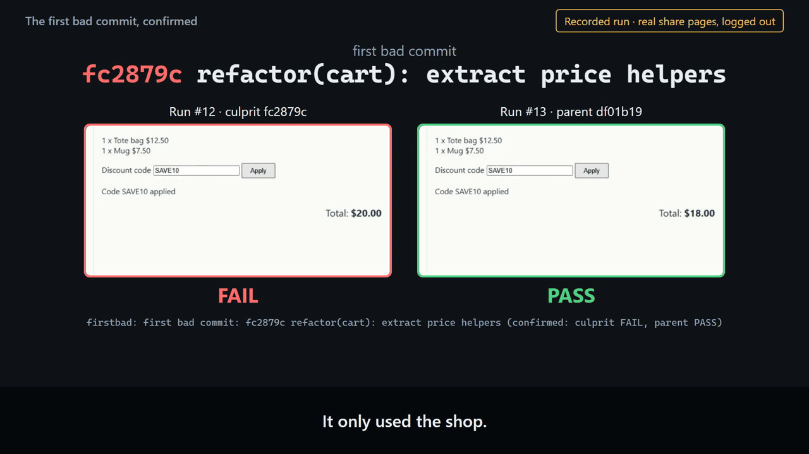
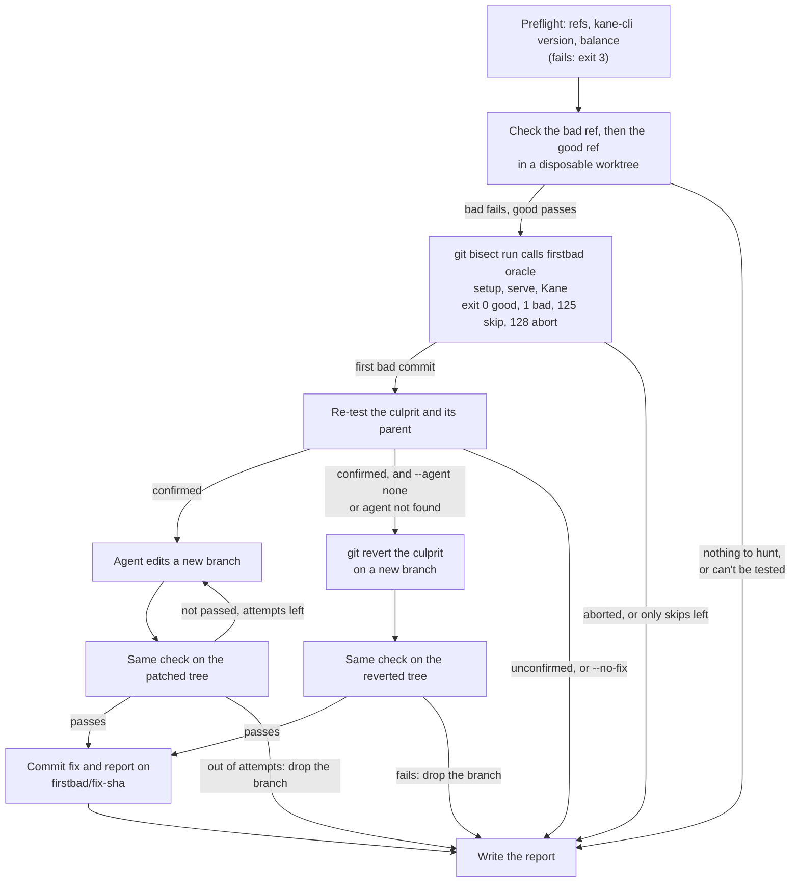

<!-- readme-schema: R3-cli-tool v1 -->
<div align="center">

**[▶ Watch the demo video (3:58)](https://youtu.be/YJ_J-Str4K4)**

# firstbad

**git bisect with a real browser as the judge. It names the first bad commit and proves your agent's fix.**


</div>

Checkout shows the wrong total. The fix is probably a few lines, but first you've got to find the commit
that broke it, and with a manual `git bisect` the test is you: check out, rebuild, click through the flow,
type good or bad. Then again.

Coding agents make it worse. They land lots of small commits that nobody clicked through, so by the time
somebody notices, there's a long stretch of history and no idea which commit did it.

**firstbad runs `git bisect` with Kane CLI reading a real browser, names the first bad commit, and only
commits your agent's fix if that same check then passes.**

[Demo video](#demo) · [Recorded run](docs/demo/recorded-run/report.md) · [How it works](#how-it-works) · [Run locally](#quickstart)

> **Stage: hackathon build, Windows only.** One full live run is recorded: 11 Kane runs on a generated
> demo shop, 25 November 2026. The macOS and Linux paths have never been run. Ctrl+C cleanup was verified
> in a Windows console only. Every Kane run spends real TestMu AI credits. In the demo video, the terminal
> scenes after the live start are a labelled replay of that recorded run.

## Demo

[](https://youtu.be/YJ_J-Str4K4)

**[Watch on YouTube](https://youtu.be/YJ_J-Str4K4)** (3:58). Chapters: 0:00 the bug · 0:16 what firstbad is ·
0:30 setup and a live start · 0:58 can the check tell good from bad? · 1:20 a real Kane run, logged out ·
1:42 three commits skipped · 2:03 bisect narrows · 2:23 first bad commit, confirmed · 2:47 Claude's
one-line fix · 3:12 Kane proves the fix · 3:36 report and cost · 3:48 try it.

The opening shop scene is driven by a script, not by Kane. The setup scene has a short live terminal clip,
cut after the first Kane run starts. Later terminal scenes are a time-compressed replay of the recorded run.

### See it without running anything

| What | Where |
|---|---|
| The report from the recorded run: every step, verdict and credit | [report.md](docs/demo/recorded-run/report.md) ([JSON](docs/demo/recorded-run/report.json)) |
| The full terminal transcript, local paths scrubbed | [transcript.txt](docs/demo/recorded-run/transcript.txt) |
| Kane's own pages, no login: the two ends of the range | [bad ref, $20.00](https://test-manager.lambdatest.com/projects/01M899H8F9DARJYGYYYP58JYTY/test-cases/01M8ADFGA48G2V8YKDFXYF4GXJ/dashboard/share/US_NV5QX9I7T7T7KQK9QVNLNX6ON4GJI65Y1TZFUP5Z5RNU74OCZZE2CHL4QX5NRVFB?type=summary&agentView=true&fqdn=summary-page) · [good ref, $18.00](https://test-manager.lambdatest.com/projects/01M899H8F9DARJYGYYYP58JYTY/test-cases/01M8ADK9CV0HZEPZTD39CHYPBD/dashboard/share/US_GKXSQ675NL2AV22DEIUS7MUGKQSRHKLYT8SKVI6FV8N8I45PT0CLYU1BGSE5W9TL?type=summary&agentView=true&fqdn=summary-page) |
| The confirm step | [culprit, $20.00](https://test-manager.lambdatest.com/projects/01M899H8F9DARJYGYYYP58JYTY/test-cases/01M8AEDANKEW0KD6PRRV8A21KF/dashboard/share/US_W4OHC845S8BD6IFJJUDXEDAZ8ZHWKS5I03Z1OEBDKVY887DTKYRNLN45H273LZDA?type=summary&agentView=true&fqdn=summary-page) · [parent, $18.00](https://test-manager.lambdatest.com/projects/01M899H8F9DARJYGYYYP58JYTY/test-cases/01M8AEGT5R4SM1E1GZC67H3VAT/dashboard/share/US_KHMKVXADLMJWG7IW5QZLLWDYHL4FEVKH7HO6NWRHO8NM1KN43LTVZBNKBD03BFB7?type=summary&agentView=true&fqdn=summary-page) |
| The fix being proven | [patched tree, $18.00](https://test-manager.lambdatest.com/projects/01M899H8F9DARJYGYYYP58JYTY/test-cases/01M8AEM1XFKCRNT5YEHECSPT1C/dashboard/share/US_R6CXXZM0OWXK7T842LYYSKD5LEQLA3EUDNEMERRE0TNXRMSRU8CXMM8BQT21T1MD?type=summary&agentView=true&fqdn=summary-page) |
| The video | [youtu.be/YJ_J-Str4K4](https://youtu.be/YJ_J-Str4K4) |

On a Kane page, click the last step (or press Autoplay) to see the total it read.

## What it does

You describe one check in plain English: what to do on the page, which value to store, and what it should
be. Give firstbad a known-good ref and a command that serves your app. It proves the check fails on the bad
ref and passes on the good one, lets `git bisect run` use Kane CLI (headless Chrome, one run at a time) as
the oracle, then re-tests the culprit next to its parent. A commit that fails some other way (it won't
build, the page never loads, it shows a third value) is skipped, not blamed. Last, your coding agent gets
the culprit's diff and the value Kane read, and its patch is committed only if Kane's re-run passes.

### Why this exists

- **Manual bisect** works, but you're the oracle, and every step costs you a rebuild and a click-through.
- **Unit tests** can't bisect a flow they never covered. The bug you're hunting is often the one nobody
  wrote a test for.
- **Asking the agent to check its own work** lets whoever wrote the change grade it. Here the agent never
  decides pass or fail. The value Kane reads from the patched app does.

## Quickstart

```bash
npm install -g @testmuai/kane-cli
kane-cli login --oauth
git clone https://github.com/Dotman-Bei/firstbad
cd firstbad
npm ci
npm run build
node dist/cli.js demo
```

`demo` generates a 40-commit "Corner Shop" history in `./firstbad-demo/shop` (same commit SHAs every time,
since author and dates are fixed), hunts its planted checkout regression with Kane, skips an unrelated
broken stretch of history, confirms the culprit, asks Claude Code to fix it and proves the fix with Kane.
The report lands in `./firstbad-demo/report/`. No Claude Code? Run `node dist/cli.js demo --agent none` and
firstbad reverts the culprit and checks the revert instead. It spends real credits: the recorded run cost
about 200.

## Built at KaneCLI Online Hackathon 2026

- Event: KaneCLI Online Hackathon by TestMu AI (https://www.kaneclihack.sh/), 12 to 26 November 2026.
- Category: 02 WORKFLOW "Workflows with a spine", the page's own "git bisect on autopilot" idea.
- Team: solo builder (Dotman-Bei).
- Built during the event: everything in this repository. The first commit is from 25 November 2026.
- Kane CLI is the oracle: the value it stores decides every bisect step that reaches a browser, and that
  value goes into the agent's brief.

## Install

Requirements: Node.js 20 or later, git (built and run with 2.54 on the build machine; that's the version
used, not a verified minimum), Google Chrome, and kane-cli 0.10.9 or later installed with npm (not pnpm) and
logged in. The default agent is the Claude Code CLI (`claude`). You can pass another
command with `--agent` (it gets the prompt on stdin), though only Claude Code has been run live.

```bash
npm install -g @testmuai/kane-cli
kane-cli login --oauth
kane-cli balance
git clone https://github.com/Dotman-Bei/firstbad
cd firstbad
npm ci
npm run build
npm link
firstbad --help
```

Every Kane run spends real TestMu AI credits and takes real time. In the recorded run, each step that used
Kane took roughly 1.5 to 2.5 minutes, and 11 runs cost 200.53 credits by the balance (Kane's own
`credits_consumed` added up to less, so firstbad reports the balance change). firstbad refuses to start
below `FIRSTBAD_MIN_BALANCE` credits.

## Usage

Hunt the commit that broke your checkout total:

```bash
firstbad hunt --good v1.0 \
  --serve "npm start" --setup "npm ci" \
  --url http://127.0.0.1:3000/ \
  --do "add the Tote bag to the cart, add the Mug to the cart, type SAVE10 into the discount code field and click Apply" \
  --store "the total amount shown next to the word Total" \
  --expect "\$18.00"
```

That's bash syntax. In PowerShell, put it on one line and write `--expect '$18.00'` (single quotes), or the
shell eats the dollar sign.

firstbad prints one line per verdict (bracket, bisect, confirm, fix), names the first bad commit, commits
the verified fix on a new local branch `firstbad/fix-<sha>` together with `firstbad-report.md` and
`firstbad-report.json`, and writes the report to `.git/firstbad/reports/<time>/` (or `--out <dir>`). It
never pushes and never touches your checkout: the hunt runs in a disposable git worktree.

Use only the oracle inside your own bisect:

```bash
firstbad oracle --session <session.json>
```

## Commands / API reference

| Command | What it does |
|---|---|
| `firstbad hunt --good <ref> --url <url> --do "<steps>" --store "<what>" --expect "<value>" --serve "<cmd>"` | Bracket, bisect, confirm and fix. Options: `--bad <ref>` (default `HEAD`), `--setup "<cmd>"` (run per commit), `--agent "<cmd>"` or `--agent none`, `--no-fix`, `--out <dir>`, `--repo <path>`, `--objective "<text>"` |
| `firstbad demo [--dir <path>] [--port <n>] [--agent "<cmd>" \| --agent none] [--no-fix] [--force]` | Generate the Corner Shop history and run the whole loop on it |
| `firstbad oracle --session <file>` | A `git bisect run` script: exit 0 good, 1 bad, 125 skip, 128 abort |
| `firstbad clean [--repo <path>]` | Remove leftover firstbad worktrees and session folders |
| `firstbad --version`, `firstbad --help` | Version and usage |

`--objective` replaces the Kane objective firstbad would write. It has to start with `Go to http://` or
`Go to https://` and store the value as `'observed'`. With it, `--do` and `--store` are optional.

Exit codes of `hunt` and `demo`: 0 = confirmed culprit and a fix Kane verified (or `--no-fix`), 1 = the hunt
ran without that, 2 = usage error, 3 = preflight failed (kane-cli missing or older than 0.10.9, not logged
in, balance below the floor, bad refs), 130 = interrupted.

| Environment variable | Default | Purpose |
|---|---|---|
| `FIRSTBAD_KANE` | `kane-cli` | The Kane command |
| `FIRSTBAD_MIN_BALANCE` | `500` | Refuse to start below this many credits |
| `FIRSTBAD_MAX_RUNS` | `16` | Cap on Kane runs per hunt (retries count) |
| `FIRSTBAD_MAX_FIX_ATTEMPTS` | `3` | Agent attempts before giving up |
| `FIRSTBAD_KANE_TIMEOUT_SEC` | `300` | Kane `--timeout`; firstbad kills Kane 60 s later |
| `FIRSTBAD_AGENT_TIMEOUT_SEC` | `900` | Kill timer for one agent attempt |
| `FIRSTBAD_READY_TIMEOUT_SEC` | `30` | How long the served URL may take to answer |
| `FIRSTBAD_SETUP_TIMEOUT_SEC` | `600` | Kill timer for the setup command |
| `FIRSTBAD_KEEP_SESSION` | unset | `1` keeps the temporary session folder (it holds Kane evidence packs: never commit it) |
| `NO_COLOR` | unset | Plain output |

## How it works



### The mechanism, step by step

1. **Preflight.** `--good` must be an ancestor of `--bad` (default `HEAD`), kane-cli must be 0.10.9 or later,
   and the balance at least `FIRSTBAD_MIN_BALANCE`. If not, exit 3.
2. **The check becomes a Kane objective.** firstbad writes it store-first:
   `Go to <--url>, <--do>, then store <--store> in a variable named 'observed'`. Each check is
   `kane-cli run "<objective>" --agent --headless --timeout 300 --max-steps 25`, from a temporary folder.
3. **firstbad does the comparing.** It reads the stored value from Kane's `run_end` line and compares it
   with `--expect` itself. Kane's own pass or fail doesn't decide anything. The value is read from `observed`
   if that key exists, else the only stored key besides the page URL, else the only key whose name shares a
   word with your `--store` phrase. No match or several matches count as no value, retried once. A key is
   never picked by its value.
4. **Bracket.** The bad ref must fail with a stored value (that value becomes the bad signature) and the
   good ref must pass. If Kane can't store anything on the bad ref, you're told the check looks mis-phrased.
5. **Bisect.** `git bisect run` calls `firstbad oracle`, which runs `--setup`, starts `--serve`, waits for
   `--url`, runs Kane and exits: **0** the value matches `--expect`, **1** it matches the bad signature,
   **125** skip (setup failed, page never loaded, Kane error or no value after one retry, a third value),
   **128** abort (auth failure, `FIRSTBAD_MAX_RUNS` reached, port already busy).
6. **Confirm.** Culprit FAIL and parent PASS, or the hunt says it's unconfirmed.
7. **Fix.** The check, the value Kane stored and the culprit's diff go to the agent on a new branch. The
   default is `claude -p --permission-mode acceptEdits --allowedTools Read,Edit,Write,Glob,Grep`. Kane
   re-runs the same check on the patched tree, up to three attempts (`FIRSTBAD_MAX_FIX_ATTEMPTS`). An
   attempt that changes nothing counts, with no Kane run. Use `--agent none` to prove a revert instead, or
   `--no-fix` to stop at the culprit.
8. **Report.** Only an allow-list of fields, scrubbed of anything token-shaped. Kane runs outside your
   repository, so its `.testmuai/` output and evidence packs (which can hold bearer tokens) stay out of it.

### Live evidence

All from one recorded run of `demo` on Windows, 25 November 2026. The sources are
[report.md](docs/demo/recorded-run/report.md), [report.json](docs/demo/recorded-run/report.json) and
[transcript.txt](docs/demo/recorded-run/transcript.txt). The video replays it.

| What happened | Number | Proof level |
|---|---|---|
| History searched | 40 commits, `v1.0` to `6f9b864` | Live run transcript |
| Bad ref, then good ref | $20.00 FAIL, $18.00 PASS | Live Kane runs, share pages [#1](https://test-manager.lambdatest.com/projects/01M899H8F9DARJYGYYYP58JYTY/test-cases/01M8ADFGA48G2V8YKDFXYF4GXJ/dashboard/share/US_NV5QX9I7T7T7KQK9QVNLNX6ON4GJI65Y1TZFUP5Z5RNU74OCZZE2CHL4QX5NRVFB?type=summary&agentView=true&fqdn=summary-page), [#2](https://test-manager.lambdatest.com/projects/01M899H8F9DARJYGYYYP58JYTY/test-cases/01M8ADK9CV0HZEPZTD39CHYPBD/dashboard/share/US_GKXSQ675NL2AV22DEIUS7MUGKQSRHKLYT8SKVI6FV8N8I45PT0CLYU1BGSE5W9TL?type=summary&agentView=true&fqdn=summary-page) |
| Broken commits skipped | 3 skips, 0 Kane runs | Live run transcript (no Kane page: Kane never ran) |
| Bisect verdicts from Kane | 6 | Live Kane runs, share pages in [report.md](docs/demo/recorded-run/report.md#kane-test-manager-links) |
| Culprit | `fc2879c` "refactor(cart): extract price helpers": $20.00 FAIL, parent $18.00 PASS | Live Kane runs, share pages [#12](https://test-manager.lambdatest.com/projects/01M899H8F9DARJYGYYYP58JYTY/test-cases/01M8AEDANKEW0KD6PRRV8A21KF/dashboard/share/US_W4OHC845S8BD6IFJJUDXEDAZ8ZHWKS5I03Z1OEBDKVY887DTKYRNLN45H273LZDA?type=summary&agentView=true&fqdn=summary-page), [#13](https://test-manager.lambdatest.com/projects/01M899H8F9DARJYGYYYP58JYTY/test-cases/01M8AEGT5R4SM1E1GZC67H3VAT/dashboard/share/US_KHMKVXADLMJWG7IW5QZLLWDYHL4FEVKH7HO6NWRHO8NM1KN43LTVZBNKBD03BFB7?type=summary&agentView=true&fqdn=summary-page) |
| Fix | 1 attempt by Claude Code, $18.00 PASS, commit `617eb8f` on the local demo repo's `firstbad/fix-fc2879c` | Live Kane run, share page [#14](https://test-manager.lambdatest.com/projects/01M899H8F9DARJYGYYYP58JYTY/test-cases/01M8AEM1XFKCRNT5YEHECSPT1C/dashboard/share/US_R6CXXZM0OWXK7T842LYYSKD5LEQLA3EUDNEMERRE0TNXRMSRU8CXMM8BQT21T1MD?type=summary&agentView=true&fqdn=summary-page); [the diff](demo/data/fix-617eb8f.diff) |
| Kane runs | 11 | Live run report |
| Credits, as Kane reported them | 188.77 | Live run report |
| Credits, by balance | 200.53 (10983.139 to 10782.6135) | Live run report |
| Wall clock | 1311 s, about 22 minutes | Live run transcript header |

### What is real and what is not

| | Status |
|---|---|
| Bracket, bisect, skip, confirm | **Real**, run live against Kane CLI 0.10.9 on the demo shop |
| Agent fix, re-verified by Kane | **Real**, run live with Claude Code, passed first try |
| The demo shop and its bug | **Generated and planted** by `firstbad demo`. No recorded live hunt on any other app |
| `--agent none` revert, `--setup`, `--objective`, other agents | **Tested against a stub Kane or stub agent at most**. No recorded live run |
| The 93 tests | **Real**, and offline: a stub stands in for Kane, so they spend no credits |
| Windows 10 | **Built and run there** |
| macOS and Linux | **Never run** |
| Ctrl+C and Ctrl+Break cleanup | **Verified in a Windows console only**, not mintty or Windows Terminal |
| Demo video | Short live start, then a **labelled replay** of the recorded run. Its opening shop scene is **script-driven** |

### Hard problems: four things Kane did

- **Green isn't correct.** With a store-only objective, Kane reports passed on a page showing $20.00, so
  firstbad judges the value instead ([spike runs](docs/spike/kane-spike.md#runs)).
- **Your variable name is a suggestion.** Asked for `observed`, all 11 recorded runs stored `cart_total`
  ([report.json](docs/demo/recorded-run/report.json), `observedKey`).
- **Asserting on a failing page lost the value.** When the objective also asserted $18.00, the failed run
  on the $20.00 page came back with an empty `final_state` ([spike templates](docs/spike/kane-spike.md#templates)).
- **`credits_consumed` under-reports.** It summed to 188.77 while the balance dropped 200.53
  ([report cost](docs/demo/recorded-run/report.md#cost)).

### Repository map

```
src/                       the CLI: hunt, oracle, fix, report, clean
src/kane/                  runs kane-cli and parses its NDJSON
src/demo/                  generates the Corner Shop history
test/                      93 tests, with stub Kane and stub agent fixtures
docs/demo/recorded-run/    report and transcript of the live run
docs/spike/                the day-one Kane experiment that fixed the objective wording
demo/                      the demo video's source, its own package
scripts/                   records and checks the live run, runs the spike
```

## Roadmap

Known limits:

- Two bugs with different bad values in one range can make bisect skip the true culprit, because that commit
  shows a third value. The confirm step catches this and reports the hunt as unconfirmed.
- A busy port aborts the hunt with a clear error instead of testing someone else's server.
- One stored value per check, and Kane runs are serial: each one takes real minutes and credits.
- Built and exercised on Windows 10. The macOS and Linux code paths (process-group kill, signal forwarding
  to the oracle, `sh` setup and serve commands) are written but have never been run.
- Ctrl+C or Ctrl+Break during a hunt stops every process firstbad started (the app server, Kane,
  `git bisect run` and the oracle under it), then removes the worktree and session folder and exits 130; a
  second Ctrl+C exits at once. This was verified in a Windows 10 console window, not in Git Bash's mintty or
  Windows Terminal. If firstbad itself is killed without a signal (Task Manager, `taskkill /F`), nothing can
  run its cleanup: stop what still holds the port (`netstat -ano | findstr :<port>`, then
  `taskkill /pid <pid> /T /F`) and run `firstbad clean`. Whatever cleanup can't remove, firstbad prints
  along with the command to remove it by hand.

Next: cheaper re-verification by replaying Kane's recorded test where replays prove faithful, and a GitHub
Action that runs a hunt when a flow check starts failing.

## License

MIT, see [LICENSE](LICENSE).
